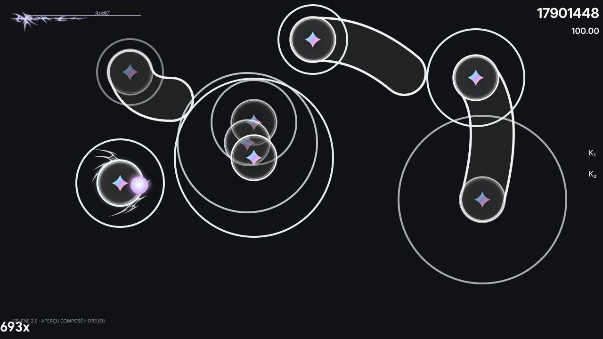
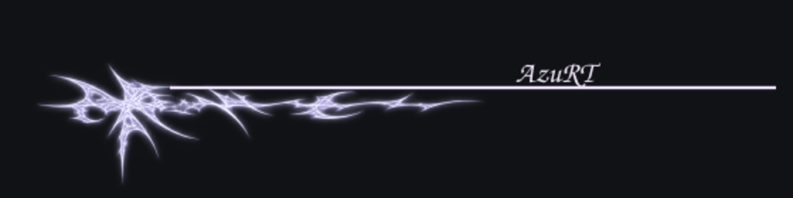
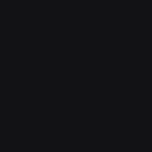
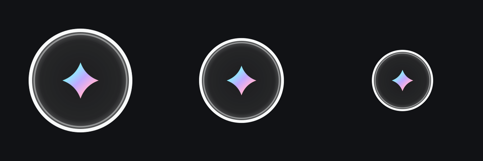
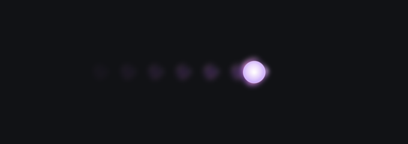

<h1 align="center">SELENE 2.0</h1>

La nuit, en rythme. Un skin osu! personnalisé pour AzuRT.

<a href="https://guestop89.github.io/selene-osu-skin/">Découvrir la vitrine</a> · <a href="https://github.com/guestop89/selene-osu-skin/raw/refs/heads/main/downloads/SELENE-V2.0.osk">Télécharger le skin</a> · <a href="downloads/SELENE-V2.0-complet.zip">Pack complet</a>

## Une nouvelle identité

- Anneaux blancs et centres sombres translucides.
- Prismes cyan, lavande, rose et or, légèrement agrandis.
- Curseur rond nacré et traînée violette courte.
- Ailes blanches de slider, animées et orientées suivant la trajectoire. Le prisme central garde son orientation.
- Signature AzuRT calligraphique au-dessus de la barre de vie lavande.
- Combo en Google Sans, environ 20 % plus petit, avec son rebond natif.

## En mouvement

Les 32 images des ailes utilisent la cadence native de la balle de slider, liée à sa vitesse dans lazer. Les aperçus sont composés à partir des fichiers du skin et l’animation est une simulation hors jeu.

## Installer

1. Télécharger [SELENE V2.0.osk](downloads/SELENE-V2.0.osk).
2. Ouvrir le fichier dans osu!, puis attendre son import.
3. Sélectionner **SELENE V2.0** dans les options de skin.

Le [pack complet](downloads/SELENE-V2.0-complet.zip) contient le skin, les aperçus, le guide et les sources de reconstruction. Les [sources](sources/SELENE-V2.0-sources.zip) sont aussi disponibles séparément. Les empreintes des téléchargements figurent dans [SHA256SUMS.txt](downloads/SHA256SUMS.txt).

## Compatibilité

Format legacy pour osu!stable et osu!lazer. Les menus visent surtout stable et le HUD personnalisé concerne lazer. Les tailles du curseur et du HUD dépendent des réglages du client. Le fond et les objets joués dépendent de la beatmap.

L’intégrité de l’archive, les PNG SD/HD, la conservation des 99 sons et des ressources mania, les animations et les liens ont été vérifiés. L’import et le gameplay dans un client osu! restent à confirmer. Voir le [guide](GUIDE.md) et les [notes de version](CHANGES.md).

## Crédits et versions précédentes

Personnalisation pour AzuRT. Ornements retravaillés depuis une référence fournie avec image_gen, puis intégrés et animés dans les ressources du skin. Les motifs constituent une interprétation de la référence. Signature en Z003 et combo en Google Sans, rasterisés en PNG. Aucun fichier de police n’est redistribué. Les contenus tiers conservent leurs crédits respectifs. Pas d’affiliation officielle avec osu!.

[SELENE V1.3 Glow](downloads/SELENE-V1.3-Glow.osk) · [Ribbon Edition](downloads/SELENE-Ribbon.osk)
