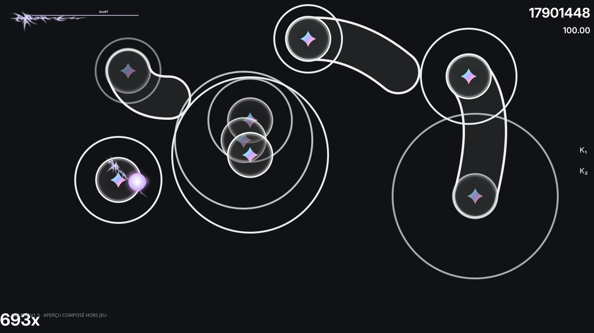

# SELENE V1.5 Reference

[Télécharger le skin](downloads/SELENE-V1.5-Reference.osk)

Cercles et sliders à contours blancs, centres turquoise, curseur en étoile lumineuse et barre de vie lavande à motif fin. Importer le .osk dans osu! et choisir SELENE V1.5 Reference.

Éléments redessinés depuis une capture fournie par AzuRT. Le fond de jeu dépend de la beatmap. Les ornements sont une interprétation, les fichiers du skin original ne sont pas fournis. Le pack a été vérifié techniquement et reste à essayer dans le client.

