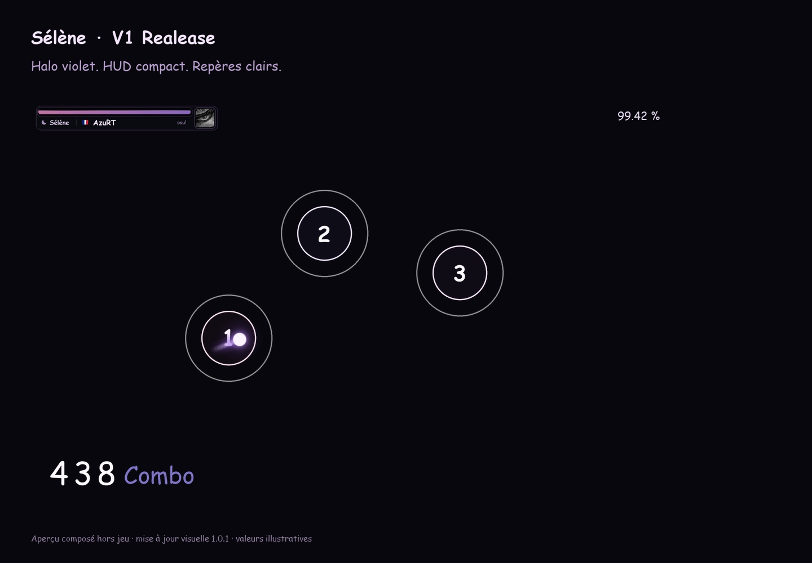
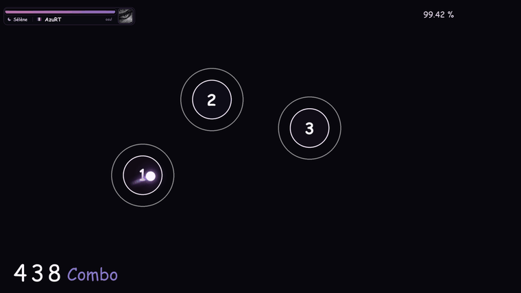

<h1 align="center">SELENE V1 Realease</h1>

La nuit, en rythme. Un skin osu! rose et violet, personnalisé pour <a href="https://osu.ppy.sh/users/38408224">AzuRT</a>.

<a href="https://guestop89.github.io/selene-osu-skin/">Découvrir la vitrine</a> · <a href="https://github.com/guestop89/selene-osu-skin/raw/refs/heads/main/downloads/SELENE-V1-Realease.osk">Télécharger la V1</a> · <a href="GUIDE.md">Guide du skin</a>

## Dans la V1

- Ronds à bord blanc, centres transparents teintés de rose, lavande et orchidée ; grands chiffres arrondis.
- Curseur violet lumineux de 88 px, stable au clic, et traînée courte. Variantes de 64 et 96 px fournies.
- Barre de vie rose/violet animée à 60 i/s, avec un bloc relié réunissant Sélène, le drapeau français, AzuRT et son avatar osu!.
- Combo réel avec chiffres blancs, suffixe « Combo » violet et rebond natif du client.
- `:3` vert pour 100, bleu pour 50, petite croix pour miss ; 42 frames de rebond et de fondu. Parfaits invisibles.
- Hitsounds courts et interface cartoon. Assets propres aux autres modes conservés.

## Installer

1. Télécharger [SELENE V1 Realease.osk](https://github.com/guestop89/selene-osu-skin/raw/refs/heads/main/downloads/SELENE-V1-Realease.osk).
2. Ouvrir le fichier ou le glisser dans osu!, puis attendre l’import.
3. Choisir **SELENE V1 Realease** dans les options de skin.

Chaque `.osk` est complet ; aucune ancienne version n’est requise. Les [tailles de curseur](downloads/SELENE-cursor-options.zip) et les [sources modifiables](sources/SELENE-V1-sources.zip) sont facultatives.

## Première édition

La première version **SELENE — Ribbon Edition** est également conservée : [télécharger l’originale](downloads/SELENE-Ribbon.osk) · [aperçu](assets/ribbon.jpg) · [sources](sources/SELENE-Ribbon-sources.zip).

## Compatibilité et limites

Format legacy pour osu!stable et osu!lazer. Les menus visent surtout stable ; le HUD personnalisé, l’accuracy et le compteur de pp concernent lazer. Le `.osk` seul ne calcule pas les pp dans stable et ne peut pas rendre le combo jaune automatiquement tous les 100.

La vitrine utilise les vrais assets dans des compositions et simulations hors jeu ; les valeurs affichées sont illustratives. Les fichiers ont été contrôlés techniquement. Aucun test d’import ou de gameplay en client n’a encore été réalisé. Les réglages de taille, sensibilité et mania restent personnels. Voir le [guide complet](GUIDE.md).

## La vitrine

HTML, CSS et JavaScript sans dépendance, sans suivi et sans service externe. Démonstration interactive des ronds, préécoute des trois familles de clics, curseur à traînée courte, vraies frames de vie et galerie agrandie. Les sons ne démarrent qu’après une action.

Pour prévisualiser, servir la racine avec un serveur HTTP statique. GitHub Pages doit servir la branche `main`, dossier `/ (root)`. Le fichier `.nojekyll` désactive le traitement Jekyll.

## Crédits

Design original personnalisé pour AzuRT, réalisé avec Codex. Références de direction artistique : Mizuki / Sleepy / Aristia et Sorasaki Hina, sans reprise de leurs fichiers. Avatar issu du profil osu! fourni par AzuRT. Glyphes Windows rasterisés en PNG ; aucun fichier de fonte Windows redistribué. Images et sons synthétisés dans les sources jointes. Pas d’affiliation officielle avec osu!.

Les images et les sons du skin ainsi que l’avatar ont leurs crédits respectifs ; aucune licence globale n’est attribuée à des contenus tiers.

